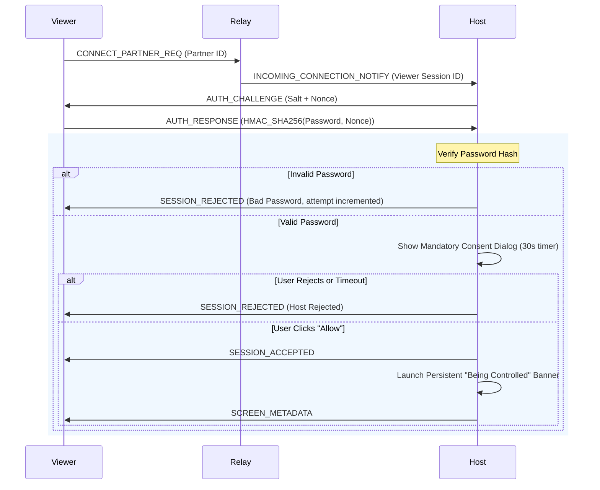

# Architecture & Protocol Design: Clean-Room Remote Desktop

## 1. System Architecture Overview

The system is architected as a Maven multi-module project targeting Java 21+ with Netty 4.1:

```
ultraveiwer-java/
├── pom.xml                     (Root Aggregator POM)
├── shared-protocol/            (Network Protocol, Frame Codecs, TLS Utilities, Data Models)
├── relay-server/               (Headless Netty Server for NAT Traversal & Session Routing)
└── client-app/                 (JavaFX Application: Host Agent & Viewer Client)
```

---

## 2. Network Protocol Specification

### 2.1 Transport Layer & Security
- **Transport**: TCP via Netty with custom Length-Field-Based framing.
- **Security (TLS 1.3)**:
  - All control, screen, input, file transfer, and chat packets are encrypted over TLS.
  - Self-signed certificates with dynamic trust anchors or pre-configured relay CA.
  - No plaintext fallback is allowed.

### 2.2 Wire Framing Format
Every message on the wire is encoded using a binary length-prefix followed by an envelope header and payload:

```
+-------------------+--------------------+-----------------------+----------------------+
| Length (4 bytes)  | Magic (2 bytes)    | Msg Type (2 bytes)    | Sequence ID (4 bytes)|
| [uint32 big-endian| 0x55 0x56 ("UV")   | Type Identifier       | Monotonic uint32     |
+-------------------+--------------------+-----------------------+----------------------+
| Timestamp (8 bytes| Payload Length (4b)| Binary / JSON Payload                        |
| uint64 epoch ms   | uint32             | (Length - 20 bytes)                          |
+-------------------+--------------------+----------------------------------------------+
```

### 2.3 Packet Types & Identifiers

| Type ID | Enum Name | Description | Direction |
| :--- | :--- | :--- | :--- |
| `0x0001` | `REGISTER_HOST_REQ` | Host announces itself to Relay with optional preferred ID | Host -> Relay |
| `0x0002` | `REGISTER_HOST_RESP` | Relay confirms assigned numeric 9-digit Host ID | Relay -> Host |
| `0x0003` | `CONNECT_PARTNER_REQ`| Viewer initiates session with target Partner ID | Viewer -> Relay |
| `0x0004` | `AUTH_CHALLENGE` | Host provides salt/nonce to Viewer via Relay | Host -> Viewer |
| `0x0005` | `AUTH_RESPONSE` | Viewer submits password proof (HMAC-SHA256) | Viewer -> Host |
| `0x0006` | `CONSENT_PROMPT` | Host triggers user consent dialog | Host internal / Relay |
| `0x0007` | `SESSION_ACCEPTED` | Session established, streaming permitted | Host -> Viewer |
| `0x0008` | `SESSION_REJECTED` | Wrong password, rejected consent, or timeout | Host -> Viewer |
| `0x0009` | `SESSION_TERMINATE` | Instant disconnection request | Either -> Relay |
| `0x0010` | `SCREEN_METADATA` | Screen resolution, monitor count, tile grid spec | Host -> Viewer |
| `0x0011` | `SCREEN_TILE_BATCH` | Batch of compressed dirty tiles (JPEG/PNG) | Host -> Viewer |
| `0x0012` | `QUALITY_SETTINGS` | Viewer requests quality / scaling mode change | Viewer -> Host |
| `0x0020` | `MOUSE_EVENT` | Mouse move, click, release, scroll | Viewer -> Host |
| `0x0021` | `KEYBOARD_EVENT` | Key press, release, typed unicode | Viewer -> Host |
| `0x0022` | `SYSTEM_ACTION` | Ctrl+Alt+Del trigger, lock screen | Viewer -> Host |
| `0x0030` | `CLIPBOARD_DATA` | Clipboard text payload | Bidirectional |
| `0x0040` | `CHAT_MESSAGE` | Chat message payload | Bidirectional |
| `0x0050` | `FILE_LIST_REQ` | Request directory contents | Bidirectional |
| `0x0051` | `FILE_LIST_RESP` | Return directory entries | Bidirectional |
| `0x0052` | `FILE_CHUNK` | Binary file chunk (32KB - 64KB) | Bidirectional |
| `0x0053` | `FILE_ACK` | Acknowledge chunk receipt & hash | Bidirectional |
| `0x0090` | `HEARTBEAT_PING` | Keepalive ping | Bidirectional |
| `0x0091` | `HEARTBEAT_PONG` | Keepalive pong | Bidirectional |

---

## 3. Session Authentication & Safety Workflows

### 3.1 Handshake Sequence



### 3.2 Consent & Safety Guarantees
1. **Mandatory Acceptance**: Even with the correct password, a session **cannot** start without host-side explicit UI confirmation.
2. **Persistent Floating Banner**: A non-minimizable banner window stays on screen at all times during an active remote session. It features an active session indicator and an instant `Disconnect` button.
3. **Instant Disconnect**: Calling disconnect aborts screen capture, cancels all timers, sends a `SESSION_TERMINATE` packet, and closes the TCP channel.
4. **Rate Limiting**: The Host Agent tracks failed authentication attempts and temporarily blocks connection attempts after 5 consecutive failures for 60 seconds.

---

## 4. Screen Capture & Streaming Pipeline

### 4.1 Dirty-Tile Algorithm
To achieve low bandwidth and high responsiveness:
1. The screen (e.g. 1920x1080) is partitioned into a uniform grid of tiles (e.g. 64x64 or 128x128 pixels).
2. For each frame cycle:
   - Capture screen buffer via `java.awt.Robot.createScreenCapture`.
   - Calculate an xxHash64 or Adler32 checksum for each tile in the current frame buffer.
   - Compare with the tile checksum from the previous frame.
   - Only dirty (changed) tiles are extracted into memory.
3. Compression:
   - Dirty tiles are compressed in parallel using Java standard ImageIO JPEG/PNG encoders.
   - Tiles are packed into a single `SCREEN_TILE_BATCH` packet with `(x, y, width, height, compressedBytes)` descriptors.
4. Adaptive Quality:
   - If the Netty socket outbound buffer exceeds high-water mark, framerate drops and JPEG compression quality drops to 40%.
   - When channel is clear, quality increases up to 85% with higher framerates (up to 30 FPS).

---

## 5. Input Injection Pipeline

1. **Viewer**:
   - Captures JavaFX mouse events (`MouseEvent.MOUSE_MOVED`, `MOUSE_PRESSED`, `MOUSE_RELEASED`, `ScrollEvent`).
   - Normalizes coordinates into a percentage range `[0.0, 1.0]` relative to the host's desktop aspect ratio.
   - Captures key events and serializes standard AWT key codes.
2. **Host**:
   - Scales percentage coordinates to actual host screen pixel bounds `(x * screenWidth, y * screenHeight)`.
   - Injects mouse movement and clicks using `java.awt.Robot.mouseMove` and `mousePress`/`mouseRelease`.
   - Checks `isViewOnly`: If View-Only is enabled, all input injection packets are discarded immediately.

---

## 6. Clipboard, Chat, and File Transfer

### 6.1 Clipboard Sync
- `java.awt.datatransfer.Clipboard` listener detects local string changes.
- Sends `CLIPBOARD_DATA` packet if the value changed externally.
- Guards against circular echo loops using last-sent hash caching.

### 6.2 In-Session Chat
- Bi-directional text messaging encoded as UTF-8 in `CHAT_MESSAGE` packets.
- Delivered instantly through the same multiplexed Netty TLS channel.

### 6.3 File Transfer
- Dedicated message types `FILE_LIST_REQ`/`FILE_LIST_RESP` allow browsing remote directory contents.
- Files are transmitted in sequenced chunks (`FILE_CHUNK` of 64 KB) with rolling hash acknowledgment (`FILE_ACK`).
- Files are saved with `.part` extensions until the final chunk is verified against the complete file SHA-256 hash.

